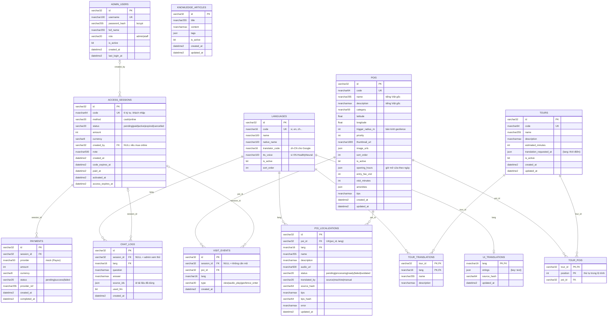

# 2. ERD — Thiết kế dữ liệu (SQL Server, 15 bảng, 13 khóa ngoại)

Cơ sở dữ liệu quan hệ **Microsoft SQL Server**, truy cập qua SQLAlchemy 2.0 (async, driver ODBC).
Lược đồ được khai báo bằng code trong [`app/db/tables.py`](../app/db/tables.py) (**Code First**): lúc khởi động,
ứng dụng tự tạo database `audio_guide` (nếu chưa có), rồi tạo các bảng, khóa chính, khóa ngoại, ràng buộc UNIQUE và chỉ mục còn thiếu.
Script SQL tương đương để đọc / chạy tay trong SSMS: [`docs/database/schema-sqlserver.sql`](database/schema-sqlserver.sql).

## Quy tắc toàn vẹn tham chiếu

Mọi khóa ngoại đều **`ON DELETE NO ACTION`** (mặc định của SQL Server): bản ghi **cha** đang được bản ghi **con**
tham chiếu thì **không xóa được** — kể cả khi xóa thẳng trong SQL Server Management Studio. SQL Server báo lỗi 547:

```
The DELETE statement conflicted with the REFERENCE constraint "fk_poi_localizations_poi_id".
The conflict occurred in database "audio_guide", table "dbo.poi_localizations", column 'poi_id'.
```

Ứng dụng bắt lỗi này ở lớp Repository và trả HTTP **409** (`REFERENCED_BY_OTHER_DATA`). Lớp Service vẫn kiểm tra trước
để báo lỗi dễ hiểu hơn (vd `POI_HAS_LOCALIZATIONS: còn 3 bản dịch`), khóa ngoại là **chốt chặn cuối** ở database.

| Muốn xóa | Bị chặn khi còn | Cách làm đúng trong ứng dụng |
|---|---|---|
| POI (`pois`) | bản dịch (`poi_localizations`), lượt tham quan (`visit_events`), nằm trong lộ trình (`tour_pois`) | Xóa các bản dịch trước; POI đã có lượt tham quan thì **ẩn** (`is_active = 0`); Service tự gỡ POI khỏi lộ trình rồi mới xóa |
| Ngôn ngữ (`languages`) | bản dịch POI / lộ trình / giao diện, lịch sử chat dùng ngôn ngữ đó | Không xóa — chỉ **tắt** ngôn ngữ (`is_active = 0`) |
| Lộ trình (`tours`) | `tour_pois`, `tour_translations` | Repository xóa 2 bảng con này **trong cùng 1 giao dịch** với lộ trình (bảng con thuộc sở hữu của lộ trình) |
| Tài khoản (`admin_users`) | mã truy cập do nhân viên đó bán (`access_sessions.created_by`) | Không xóa — **khóa** tài khoản (`is_active = 0`) |
| Phiên truy cập (`access_sessions`) | thanh toán, lịch sử chat, lượt tham quan | Không xóa — **thu hồi** (`status = cancelled`) |

Chiều ngược lại cũng được đảm bảo: không thể thêm bản ghi con trỏ tới bản ghi cha **không tồn tại**
(vd bản dịch cho POI đã bị xóa, lộ trình chứa POI không có thật) → 409 `INVALID_REFERENCE`.

## Sơ đồ quan hệ

Ảnh xuất sẵn (dán vào báo cáo): [`docs/database/erd-sqlserver.png`](database/erd-sqlserver.png).



Hai bảng kỹ thuật **không có quan hệ**: `chat_cache` (cache câu trả lời chatbot) và `media_files` (file mp3).

## Danh sách khóa ngoại

| # | Ràng buộc | Bảng con (cột) | → Bảng cha (cột) | Ý nghĩa |
|---|---|---|---|---|
| 1 | `fk_poi_localizations_poi_id` | `poi_localizations(poi_id)` | `pois(id)` | Bản dịch thuộc 1 POI |
| 2 | `fk_poi_localizations_lang` | `poi_localizations(lang)` | `languages(code)` | Bản dịch thuộc 1 ngôn ngữ |
| 3 | `fk_tour_pois_tour_id` | `tour_pois(tour_id)` | `tours(id)` | Điểm dừng thuộc 1 lộ trình |
| 4 | `fk_tour_pois_poi_id` | `tour_pois(poi_id)` | `pois(id)` | Điểm dừng là 1 POI có thật |
| 5 | `fk_tour_translations_tour_id` | `tour_translations(tour_id)` | `tours(id)` | Bản dịch tên/mô tả lộ trình |
| 6 | `fk_tour_translations_lang` | `tour_translations(lang)` | `languages(code)` | |
| 7 | `fk_ui_translations_lang` | `ui_translations(lang)` | `languages(code)` | Nhãn giao diện đã dịch |
| 8 | `fk_access_sessions_created_by` | `access_sessions(created_by)` | `admin_users(id)` | Nhân viên bán mã tiền mặt (cho phép NULL) |
| 9 | `fk_payments_session_id` | `payments(session_id)` | `access_sessions(id)` | Giao dịch của 1 phiên mua online |
| 10 | `fk_chat_logs_session_id` | `chat_logs(session_id)` | `access_sessions(id)` | Lịch sử chat của 1 phiên (cho phép NULL) |
| 11 | `fk_chat_logs_lang` | `chat_logs(lang)` | `languages(code)` | |
| 12 | `fk_visit_events_session_id` | `visit_events(session_id)` | `access_sessions(id)` | Lượt tham quan của 1 phiên (cho phép NULL) |
| 13 | `fk_visit_events_poi_id` | `visit_events(poi_id)` | `pois(id)` | Lượt xem / nghe / vào vùng của 1 POI |

Không đặt khóa ngoại (có chủ đích): `poi_localizations.audio_url` (là URL tới `media_files`, file dùng chung giữa các bản dịch
giống nội dung), `chat_logs.source_ids` (danh sách id POI hoặc bài viết, chỉ để tham khảo, bài viết bị xóa thì log cũ vẫn giữ),
`visit_events.lang` (giữ nguyên ngôn ngữ ghi nhận từ thiết bị, kể cả mã chưa có trong bảng `languages`).

## Mô hình lưu nội dung đa ngôn ngữ

- Nội dung **gốc** (tiếng Việt) nằm trong `pois`. Admin chỉ nhập tiếng Việt.
- Mỗi ngôn ngữ là **1 dòng** trong `poi_localizations`, ràng buộc UNIQUE `(poi_id, lang)`.
- `source_hash = MD5(name + description gốc)`. Bản dịch chỉ **hợp lệ** khi `source_hash` khớp nội dung gốc hiện tại → sửa mô tả gốc thì mọi bản dịch cũ tự động không được dùng nữa, hệ thống dịch lại ở nền.
- `translated_by = manual`: admin sửa tay → dịch máy không ghi đè (trừ khi chọn "Dịch lại toàn bộ").

**Vì sao tách `poi_localizations` khỏi `pois`?** Đây là chuẩn hóa: 16 ngôn ngữ × (mô tả dài + trạng thái + lỗi) không thể là cột của `pois`;
tách bảng thì thêm ngôn ngữ mới không phải sửa cấu trúc bảng, cập nhật 1 ngôn ngữ chỉ ghi 1 dòng, và truy vấn "các bản dịch đang lỗi" chỉ là `WHERE status = 'failed'`.

**Vì sao có `tour_pois`?** Quan hệ lộ trình — POI là **nhiều – nhiều** và có **thứ tự**. Trong MongoDB trước đây là mảng `poi_ids`;
trên SQL Server phải tách thành bảng trung gian, nhờ đó mới đặt được khóa ngoại tới `pois` (mảng thì không đặt khóa ngoại được).
Cột `position` giữ thứ tự tham quan.

**Cột JSON** (`NVARCHAR(MAX)`) chỉ dùng cho danh sách **không tham chiếu** bảng nào và luôn đọc/ghi cả cụm:
`image_urls`, `amenities`, `opening_hours`, `tags`, `source_ids`, `strings` (nhãn giao diện), `answer` (cache), `translation_requested_at`.

## Chỉ mục (index)

SQL Server **không tự tạo chỉ mục cho khóa ngoại**, nên mỗi cột khóa ngoại đều có chỉ mục riêng (trừ khi đã đứng đầu khóa chính / UNIQUE).

| Bảng | Khóa chính / UNIQUE / Index | Mục đích |
|---|---|---|
| languages | PK `id`; UQ `code` | `code` là đích của 4 khóa ngoại |
| pois | PK `id`; UQ `code`; IX `(is_active, sort_order)` | danh sách POI đang hoạt động |
| poi_localizations | PK `id`; UQ `(poi_id, lang)`; IX `lang`, `status` | upsert, tra cứu nhanh, tìm bản dịch dở |
| tours | PK `id`; UQ `code` | |
| tour_pois | PK `(tour_id, position)`; IX `poi_id` | thứ tự điểm dừng; kiểm tra khóa ngoại khi xóa POI |
| tour_translations | PK `(tour_id, lang)`; IX `lang` | |
| admin_users | PK `id`; UQ `username` | đăng nhập |
| access_sessions | PK `id`; UQ `code`; IX `(status, created_at)`, `created_by` | đổi mã, lọc lịch sử |
| payments | PK `id`; IX `session_id` | |
| chat_logs | PK `id`; IX `(session_id, created_at)`, `lang` | giới hạn số câu/ngày |
| visit_events | PK `id`; IX `(poi_id, created_at)`, `poi_id`, `session_id` | thống kê, biểu đồ đông khách |
| ui_translations | PK `lang` | |
| chat_cache | PK `key` (SHA-256 câu hỏi); IX `expires_at` | bỏ qua & dọn cache hết hạn |
| media_files | PK `key` | file audio (key = MD5 nội dung + giọng) |

## Bảng phụ trợ (không phải thực thể nghiệp vụ)

| Bảng | Nội dung | Ghi chú |
|---|---|---|
| `ui_translations` | `lang, strings (JSON), source_hash` | Dịch 1 lần / ngôn ngữ, dịch lại khi chuỗi gốc đổi |
| `chat_cache` | `key, answer (JSON), expires_at` | Cache câu trả lời chatbot, hết hạn sau `CHAT_CACHE_TTL_SECONDS`; bản ghi quá hạn bị bỏ qua khi đọc và bị xóa mỗi lần ghi |
| `media_files` | `key, data VARBINARY(MAX), content_type, size` | File mp3 ~50–300 KB; phục vụ qua `/media/...`, hỗ trợ tua (HTTP Range) |
